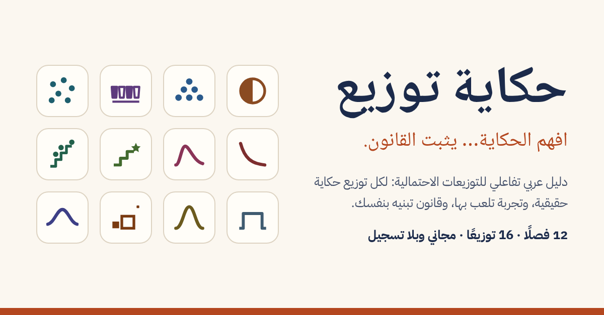

# حكاية توزيع

> افهم الحكاية… يثبت القانون.

موقع عربي تفاعلي ومجاني لطلاب الجامعة يشرح التوزيعات الاحتمالية: لكل توزيع حكاية حقيقية من التاريخ، وتجربة تلعب بها، وقانون تبنيه بنفسك خطوة خطوة.

**افتح الموقع:** https://a-almusfir.github.io/hikayat-tawzee/

## ماذا فيه؟

- **12 فصلًا** في رحلة واحدة: برنولي، ذو الحدين، فوق الهندسي، بواسون، الأسي، غاما، الهندسي، ذو الحدين السالب، المنتظم، الطبيعي، مربع كاي، t.
- **شجرة العائلة:** كيف يتفرع كل توزيع من الآخر، ومتى يقرّب أحدها غيره.
- **ليلة الاختبار:** بطاقة قوانين لكل توزيع من 16 (القانون، والمتوسط والتباين، والدالة المولدة)، ومخطط يحدد التوزيع من نص المسألة. قابلة للطباعة.
- **الدالة المولدة للعزوم:** اشتقاق المتوسط والتباين منها خطوة خطوة.
- **تدريب مختلط** على مسائل من كل الفصول.

بلا تسجيل دخول ولا إعلانات ولا تتبع، ويعمل على الجوال. كل جملة تاريخية في الموقع مربوطة بمصدر، والمصادر كاملة في صفحة «المراجع والمنهج».

## الإعداد

عبدالله المسفر — طالب إحصاء. للملاحظات والتواصل: [LinkedIn](https://www.linkedin.com/in/abdullah-a-365a082b3)

---

للمطورين: طريقة التشغيل والاختبارات وبنية المشروع في [docs/development.md](docs/development.md).
